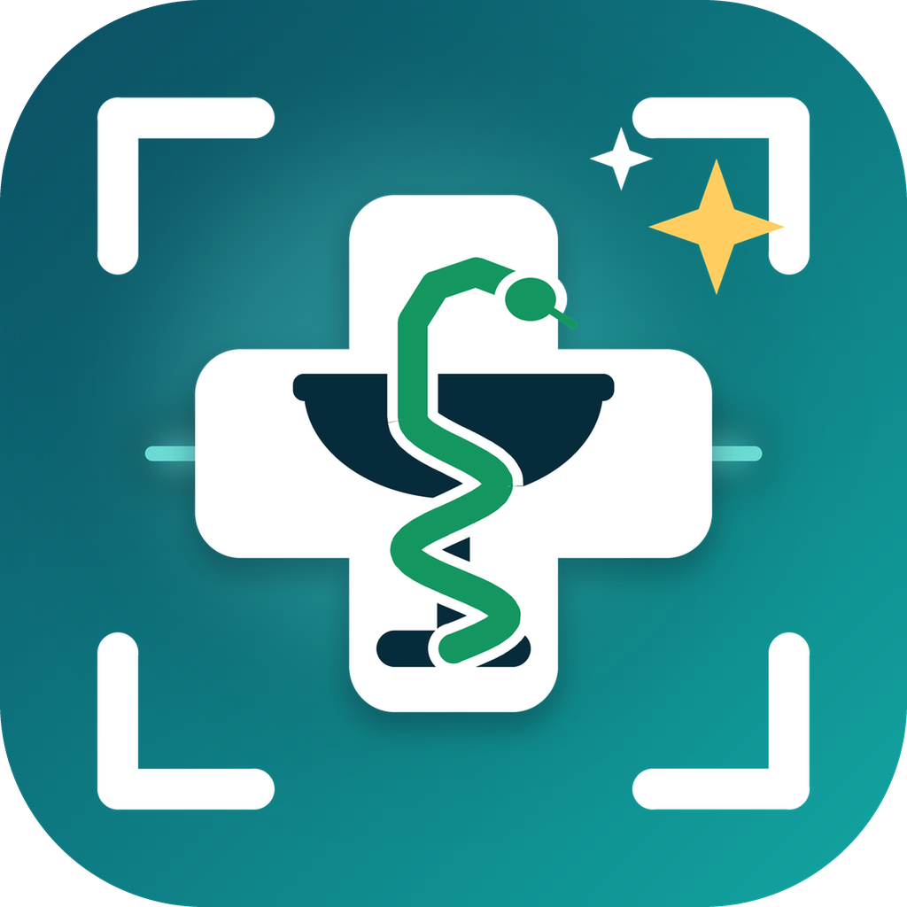

<div align="center">



# PharmaLens (فارما لينس)

### Smart AI Prescription Reader & Healthcare Assistant for Lebanon

[](https://flutter.dev)
[](https://dart.dev)
[](https://deepmind.google/technologies/gemini/)
[](#platforms-supported)
[](#license)

**Made in Lebanon 🇱🇧 by [TechWrap LB](https://www.instagram.com/techwrap.lb/)**
📷 [@techwrap.lb](https://www.instagram.com/techwrap.lb/) | 💬 [WhatsApp](https://wa.me/96170080214)

---

</div>

## 📌 Overview

**PharmaLens** is an advanced medical mobile and desktop application engineered to eliminate handwriting ambiguity in medical prescriptions, prevent medication errors, and empower patients and healthcare professionals in Lebanon with transparent, real-time drug pricing and generic alternatives.

Powered by **Google Gemini Multimodal Vision AI** and grounded in the official **Ministry of Public Health (MOPH) Lebanon Registry**, PharmaLens turns complex handwritten prescriptions into verified medications, exact dosages, official prices in Lebanese Pounds (LBP), and lower-cost bioequivalent alternatives.

---

## ✨ Key Features

### 🔍 1. AI Prescription Handwriting Recognition
- **Multimodal AI Transcription**: High-precision recognition of handwritten prescriptions, illegible doctor calligraphy, and medication packages.
- **Context-Aware OCR**: Combines on-device optical character recognition (Google ML Kit) with Gemini Vision Intelligence.
- **Doctor Specialty Detection**: Intelligently deduces the physician's medical specialty from clinic letterheads to disambiguate medication names.

### 💰 2. Official MOPH Drug Registry & Price Tariff
- **6,000+ Registered Medicines**: Comprehensive database containing official Lebanese Ministry of Public Health pricing in LBP.
- **Brand & Generic Verification**: Matches detected medications to official active pharmaceutical ingredients (APIs), strengths, and dosage forms.
- **Cheaper Generic Alternatives**: Automatically finds identical composition alternatives, highlighting potential cost savings for patients.
- **Continuous Data Synchronization**: Automatic background synchronization with official MOPH public releases, checked on every launch, plus an on-demand **Sync** button that shows each step and its percentage ("Checking for new data… 42%").

### 🤖 3. AI Assistant that answers from the app's data
- **Tool calling**: the assistant looks things up instead of guessing: MOPH search, product details, cheaper equivalents, safety checks, the user's allergies, reminders and prescriptions, doctors and nearby pharmacies ([`ChatbotTools`](lib/services/chatbot_tools.dart)).
- **Editable instructions**: its rules live in [`assets/chatbot/knowledge_notes.md`](assets/chatbot/knowledge_notes.md).
- **Prescription photos** go through the same reading and MOPH verification as a scan.
- **Safety first**: an on-device guard keeps it on health topics and answers crisis messages with Lebanese help lines (Embrace 1564, Red Cross 140). Every answer is labeled as AI.

### ⏰ 4. Reminders, alarms and family
- **Notification or alarm**: alarm mode rings with the PharmaLens tone, says the medicine name aloud and opens a Taken / Snooze screen, even on the lock screen.
- **Courses and refills**: the course length is taken from the prescription, reminders stop on the last day, and refill dates are estimated from the supply.
- **Family profiles**: allergies, conditions (pregnancy, breastfeeding, child, kidney, liver), reminders and prescriptions per person, and a shareable medicine list for doctor visits.

### 👨‍⚕️ 5. Comprehensive Lebanese Doctors Directory
- **18,600+ Licensed Physicians**: Indexed database of verified doctors practicing across Lebanon.
- **Instant Search & Filtration**: Fast search by doctor name (English & Arabic), specialty (Cardiology, Pediatrics, Oncology, etc.), and hospital affiliation.
- **Smooth Pagination**: High-performance scrolling and memory-efficient offset pagination.

### 🗺️ 6. Interactive Healthcare & Pharmacy Map
- **Universal Multi-Platform Support**: Native interactive mapping that runs seamlessly across **Android, iOS, Windows, macOS, Linux, and Web**.
- **OpenStreetMap, no Maps key**: nearby pharmacies come from Google Places, with distance, opening hours and one-tap calling/directions.

### 🌐 7. Fluent Bilingual Experience (English & Arabic)
- Full **Right-to-Left (RTL)** layout support with tailored Arabic typography, and medicine search in Arabic letters (بنادول finds Panadol).
- Seamless one-tap language switching across the entire app interface.
- Native Light and Dark themes with modern glassmorphism aesthetics.

---

## 🏗️ Architecture & Technology Stack

```
PharmaLens Architecture
 ├── Presentation Layer (Flutter Multiplatform UI)
 │    ├── Screens: Home, Prescription Analysis, Medicine Search, Doctors, Map, Settings
 │    ├── Theme: Adaptive Light / Dark Mode with PharmaLens Design System
 │    └── Localization: English & Arabic (l10n arb + runtime extensions)
 │
 ├── AI & Domain Services Layer
 │    ├── MedicalDomainGuardService (Deterministic On-Device Guardrail)
 │    ├── AiHandwritingService (Gemini Vision Multimodal REST Pipeline)
 │    ├── ChatbotService + ChatbotTools (Gemini function calling over app data)
 │    ├── MedicineVerificationService & MedicineNormalizer (Fuzzy String & Token Scoring)
 │    └── NearbyHealthcareService (Google Places & Universal Map View)
 │
 └── Data & Knowledge Layer
      ├── MophMedicineService (Local MOPH Lebanon Registry + Sync Engine)
      ├── DoctorsService (Transliterated Lebanese Doctors CSV Database)
      ├── MedicineInfoService (openFDA labels + AI summaries, cached on device)
      └── SharedPreferences Cache
```

### Technologies Used:
- **Framework**: [Flutter](https://flutter.dev) (Dart 3+)
- **AI Models**: Google Gemini 3.x Flash / Flash-Lite (Multimodal Vision & NLP)
- **Computer Vision**: Google ML Kit Digital Ink Recognition & Text OCR
- **Mapping**: Web Mercator universal map with OpenStreetMap tiles (no Google Maps SDK)
- **Data Persistence**: SharedPreferences, In-Memory Indexed Caches, and CSV/JSON Engines
- **Backend**: none. The app runs entirely on the device and calls Gemini, Google Places and openFDA directly.

---

## 📱 Platforms Supported

| Platform | Status | Features Supported |
| :--- | :---: | :--- |
| **Android** | ✅ Full Support | Camera, ML Kit OCR, map, alarms over the lock screen, Full AI Suite |
| **iOS** | ✅ Full Support | Camera, ML Kit OCR, map, reminders, Full AI Suite |
| **Web (Chrome, Edge, Safari)** | ✅ Full Support | Prescription Upload, Universal Slippy Map, Full AI Suite |
| **Windows Desktop** | ✅ Full Support | Universal Map, Full Database Search, Full AI Suite |
| **macOS & Linux** | ✅ Full Support | Desktop UI Layout, Universal Map, Full Database Search |

---

## 🚀 Getting Started

### Prerequisites
- [Flutter SDK](https://docs.flutter.dev/get-started/install) (`>= 3.3.0`)
- [Dart SDK](https://dart.dev/get-dart) (`>= 3.3.0`)
- Android Studio / Xcode / VS Code with Flutter extension
- A valid [Google Gemini API Key](https://aistudio.google.com/)

### Installation & Setup

1. **Clone the repository:**
   ```bash
   git clone https://github.com/your-username/PharmaLens.git
   cd PharmaLens
   ```

2. **Install project dependencies:**
   ```bash
   flutter pub get
   ```

3. **Configure API Keys:**
   Create or edit `lib/private/api_keys.dart`:
   ```dart
   class GeminiPrivateConfig {
     static const List<String> geminiApiKeys = [
       'YOUR_GEMINI_API_KEY_HERE',
     ];

     static const List<String> geminiModels = [
       'gemini-3.5-flash-lite',
       'gemini-flash-latest',
     ];
   }
   ```
   *(Optional)* Configure a Google Places key in `lib/private/google_maps_private_config.dart` (nearby pharmacies). The map itself is OpenStreetMap and needs no key.

4. **Run the application:**
   - **Chrome / Web:**
     ```bash
     flutter run -d chrome
     ```
   - **Windows Desktop:**
     ```bash
     flutter run -d windows
     ```
   - **Android / iOS Device:**
     ```bash
     flutter run
     ```

---

## 🧪 Testing & Code Quality

Verify codebase health and execute automated tests:

```bash
# Run static analysis
flutter analyze

# Run unit and widget tests
flutter test

# Regenerate localization files (after updating .arb files)
flutter gen-l10n
```

---

## 🔒 Privacy & Safety Disclaimer

> **Important Medical Notice:**  
> To read a prescription, its photo is sent to Google's Gemini API; everything else (prescriptions, allergies, reminders) stays on the device.
>
> PharmaLens is an artificial intelligence assistance tool built to support prescription reading, price transparency, and medication education. It does **not** replace the clinical judgment of a licensed physician or pharmacist. Always consult a certified healthcare professional before starting, altering, or stopping any medication. In medical emergencies, contact national emergency services immediately.

---

## 👥 Development Team & Credits

PharmaLens is proudly designed and developed by:

**TechWrap LB**: Lebanese developers building for patients in Lebanon 🇱🇧
- 📷 **Instagram:** [@techwrap.lb](https://www.instagram.com/techwrap.lb/)
- 💬 **WhatsApp:** [+961 70 080 214](https://wa.me/96170080214)
- 🌍 **Location:** Beirut, Lebanon    

---

## 📄 License

This project is proprietary software developed by **TechWrap LB**. All rights reserved. For commercial licensing, partnerships, or institutional inquiries, please contact the development team directly.
